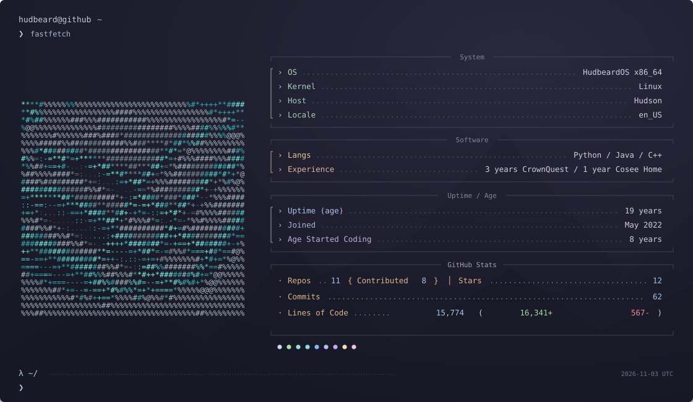

<p>
  
</p>

[`~/repos`](https://github.com/hudbeard?tab=repositories) · [`~/writing`](https://medium.com/@hudbeard) · [`~/ascii`](./assets/avatar-ascii.txt)

### A few things I've built

- [`Python-Desktop-Widgets`](https://github.com/hudbeard/Python-Desktop-Widgets) — seamless desktop widgets, built with Python.
- [`Basic3dPygame`](https://github.com/hudbeard/Basic3dPygame) — a basic 3D renderer in Pygame.
- [`coaxial_drone_code`](https://github.com/hudbeard/coaxial_drone_code) — Raspberry Pi code for a custom two-propeller drone.

<details>
<summary>cat profile.txt</summary>

<!-- profile:stats:start -->

```text
OS .................................................. HudbeardOS x86_64
Kernel .......................................................... Linux
Host ........................................................... Hudson
Uptime (age) ................................................. 19 years
Joined ....................................................... May 2022
Age Started Coding ............................................ 8 years

Langs ............................................. Python / Java / C++
Experience ..................... 3 years CrownQuest / 1 year Cosee Home

Repos .............................................................. 11
Stars .............................................................. 12
Contributed ......................................................... 8
Commits ............................................................ 63
Lines of Code .................................................. 16,208
Lines Added ................................................... 16,810+
Lines Removed .................................................... 602-

Locale .......................................................... en_US
```

<!-- profile:stats:end -->

Stats cover public repositories and non-merge commits on their default branches, deduplicated by commit SHA. Older, unlinked commits authored as `hudbeard` in my own repositories are included. Lines of Code is net authored additions minus deletions; the green and red figures show the respective totals. Binary files do not contribute line counts.

</details>

<!-- The terminal card and text stats are refreshed daily by .github/workflows/profile.yml.
     Personal details live in scripts/update_profile.py; the avatar is a true ASCII conversion
     of my GitHub profile image, stored in assets/avatar-ascii.json and avatar-ascii.txt. -->
